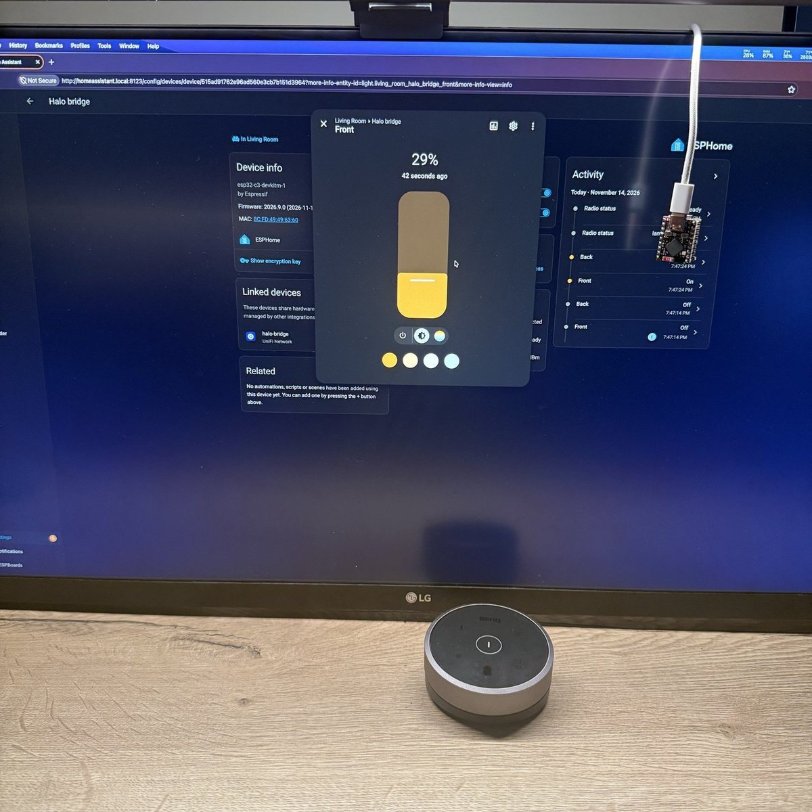
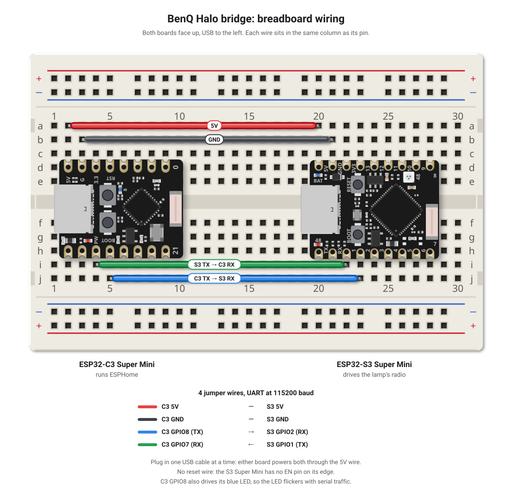
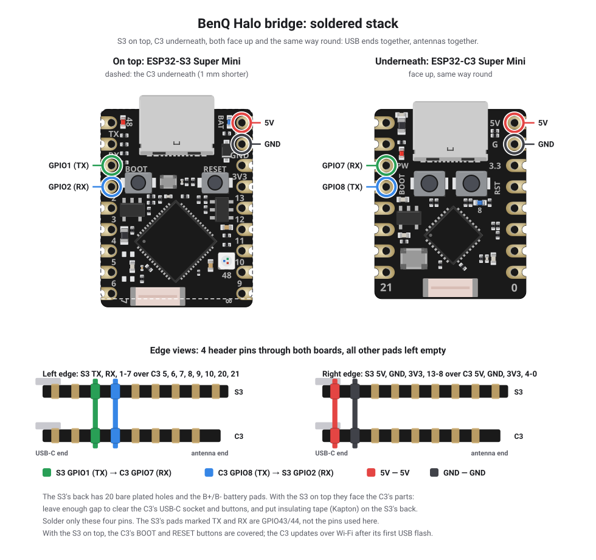
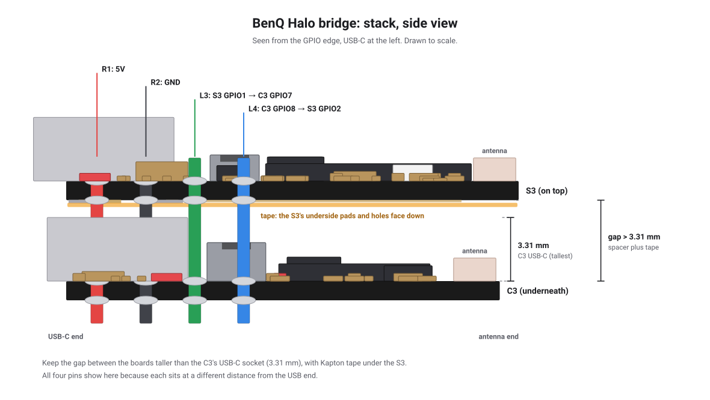
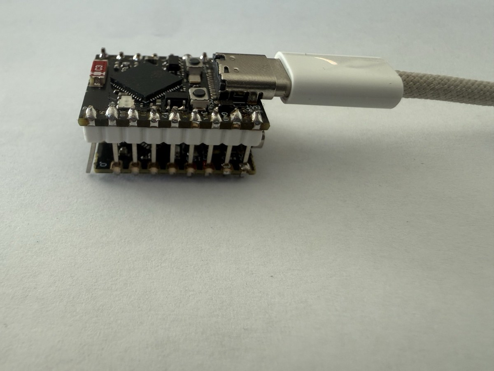

# ScreenBar Halo bridge

[](https://github.com/ESPBoards/screenbar-halo-bridge/actions/workflows/test.yml)

Home Assistant control for the first-generation BenQ ScreenBar Halo, with its
own remote still working.

**Home Assistant** ⇄ Wi-Fi ⇄ **ESP32-C3** (ESPHome) ⇄ UART ⇄ **ESP32-S3** ⇄ 2405 MHz ⇄ **lamp** and its remote

**Full write-up** with wiring diagrams and setup in Home Assistant:
[BenQ ScreenBar Halo in Home Assistant](https://www.espboards.dev/blog/benq-screenbar-halo-home-assistant/)
on espboards.dev.

Unofficial; not affiliated with or endorsed by BenQ (see
[Disclaimer](#disclaimer)). Built and tested with the Halo 1 only.



## What you get in Home Assistant

- **Front** and **Back** lights, each on/off on its own. The lamp has one
  brightness and one colour temperature, so the two lights share them.
- **Radio status** (ready, pairing, lamp didn't answer, ...) and **Radio online**.
- **Pair remote**: learns your lamp's address from its remote.
- Changes made with the remote show up in Home Assistant within a second.

## Hardware

- [ESP32-S3 Super Mini](https://www.espboards.dev/esp32/esp32-s3-super-mini/) (the radio)
- [ESP32-C3 Super Mini](https://www.espboards.dev/esp32/esp32-c3-super-mini/) (ESPHome)
- A USB-C cable, and the lamp's remote for pairing

| C3 | | S3 |
|---|:---:|---|
| GPIO8 (TX) | → | GPIO2 (RX) |
| GPIO7 (RX) | ← | GPIO1 (TX) |
| 5V | — | 5V |
| GND | — | GND |



Plug in one USB cable at a time: either board powers both. C3 GPIO8 also
drives its blue LED, so it flickers with serial traffic.

<details>
<summary><b>Solder the two boards into one stack</b></summary>

- Both boards face up, USB ends together; the four pins sit in the same edge slots.
- S3 on top: it only reflashes over USB, so its port stays reachable, and its
  antenna stays clear.
- Flash the C3 first; it updates over Wi-Fi after that.
- Solder only the four pins and leave the rest empty.
- Leave more than 3.3 mm between the boards (the C3's USB-C socket), with
  Kapton tape under the S3: its back has bare pads.

 



</details>

No reset wire is needed: the S3 restarts itself if it hangs.

## Prerequisites

- **esptool** to flash the S3: `pip install esptool`.
- **ESPHome** for the C3 (tested with 2026.9).
- This repository, at the same release as the S3 image:
  `git clone --branch v1.0.0 https://github.com/ESPBoards/screenbar-halo-bridge`

## Build and flash

Run each block from the repository root.

1. **The S3**: download `screenbar-halo-bridge-s3-v1.0.0.bin` from the
   [v1.0.0 release](https://github.com/ESPBoards/screenbar-halo-bridge/releases/tag/v1.0.0)
   and flash it over the S3's USB port:

   ```sh
   esptool --chip esp32s3 -p PORT --before usb-reset write-flash 0x0 screenbar-halo-bridge-s3-v1.0.0.bin
   ```

   `PORT` is the S3's serial port: `/dev/cu.usbmodem…` on macOS,
   `/dev/ttyACM…` on Linux, `COM…` on Windows. `--before usb-reset` also
   works with the C3 soldered on, where the normal reset into the bootloader
   fails.

   <details>
   <summary><b>Build the S3 from source instead</b></summary>

   You need **ESP-IDF at exactly commit `25fe69f946`** (master,
   `v6.1-dev-6376`). The radio code calls private PHY functions that only
   exist in this build; another version can fail silently.

   ```sh
   git clone https://github.com/espressif/esp-idf ~/esp/esp-idf-halo
   cd ~/esp/esp-idf-halo
   git checkout 25fe69f946311abdaf9ad56591f25fedbc20ac98
   git submodule update --init --recursive
   ./install.sh esp32s3
   . ./export.sh
   ```

   On Windows, run `install.bat esp32s3` and `export.bat` instead. Then, in
   that shell, from the repository root:

   ```sh
   (cd s3 && idf.py build flash)
   ```

   With the C3 soldered on, flash with the USB reset instead:

   ```sh
   (cd s3/build && esptool --chip esp32s3 -p PORT --before usb-reset write-flash @flash_args)
   ```

   The S3 talks to the C3 on UART1, TX GPIO1 and RX GPIO2 at 115200 baud;
   other pins can be set under Halo bridge in `(cd s3 && idf.py menuconfig)`.

   </details>

2. **The C3**, from the same release as the S3 (a mismatch shows "radio
   firmware mismatch"): copy `esphome/secrets.example.yaml` to
   `esphome/secrets.yaml` and fill it in (`openssl rand -base64 32` makes an
   API key). The first flash goes over USB, later ones over Wi-Fi. If you
   built the S3 from source, use a shell where `export.sh` hasn't run, or
   ESPHome picks up the wrong IDF.

   ```sh
   (cd esphome && esphome run halo-bridge.yaml)
   ```

   Using Home Assistant's ESPHome add-on? Copy the YAML there, switch
   `external_components` to the commented GitHub source (pinned to the same
   release), and add the keys from `secrets.example.yaml` to its secrets.

3. **Pair**: Home Assistant finds the new ESPHome device by itself; add it and
   paste the `api_key` from your `secrets.yaml` when asked. Then press
   **Pair remote** and turn the remote's dial. The C3 learns the lamp's
   address and keeps it.

## Options

All under `halo_bridge:` in the C3's YAML:

| Option | Default | What it does |
|---|---|---|
| `address` | | Lamp address to start with, in hex (`0x1A2B3C4D`). A paired address overrides it. |
| `listen` | `true` | `false` saves about 0.2 W, but Home Assistant then misses changes made with the remote. |
| `gain`, `retry_gain` | `4`, `6` | Transmit power, 0-10, for the first tries and for retries. Raise them if the lamp is far from the bridge. |
| `max_attempts` | `5` | Tries per command, 1-10, before "lamp didn't answer". |
| `reset_pin` | | A C3 GPIO wired to the S3's EN pin, on boards that have one. |
| `status`, `online`, `pair` | | The Radio status, Radio online and Pair remote entities; leave one out to drop it. |

Each light (`platform: halo_bridge` under `light:`) takes `zone: front` or
`zone: back`, one light per zone.

## Limitations

- **The remote only picks up Home Assistant's changes after it sleeps and
  wakes.** Until then its dial continues from the old value.
- **After both boards restart** (a power cut, say), Home Assistant shows the
  lights off even if the lamp is still lit: the bridge keeps nothing about the
  lamp across a restart. The next command or a turn of the remote fixes it.
- One lamp per bridge.
- Some cheap C3 boards can't join Wi-Fi at full power; the example config
  lowers it to 8.5 dB.

## Disclaimer

- Unofficial: not affiliated with, endorsed or supported by BenQ. BenQ and
  ScreenBar are trademarks of BenQ Corporation, named here only to say what
  this works with.
- Nothing on the lamp is opened or changed, and this repository contains no
  BenQ code or firmware. The radio protocol was worked out from the traffic
  between a lamp and its own remote, and from the projects in
  [Credits](#credits). The link isn't encrypted, so nothing is bypassed.
- Use at your own risk; there is no warranty (see [LICENSE](LICENSE)).
- The S3 drives its radio through private, undocumented PHY functions. The
  esp-sdr authors warn this "may permanently alter the radio's analog
  characteristics", and it means the module's radio certification may not
  cover this use. Follow your local radio rules, and use the lowest transmit
  power that works.

## Development

<details>
<summary><b>Repository layout</b></summary>

**`lib/`**: pure C with no ESP-IDF, tested on a PC; each folder is also an ESP-IDF component.

| Folder | What it does |
|---|---|
| `lib/lamp` | The lamp's air frames (ESB codec), payload bits, lamp state types |
| `lib/modem` | GFSK modulator, FM demodulator, frame detector, listener pipeline |
| `lib/link` | Lamp link layer: target vs known state, PID, retries |
| `lib/wire` | The C3 ↔ S3 serial protocol (COBS + CRC), shared with the C3 |

**`s3/`**: the ESP-IDF project for the S3.

| Folder | What it does |
|---|---|
| `s3/main` | Startup: wires the radio to the C3 link |
| `s3/components/phy_s3` | The radio hack: upstream-derived and frozen (`phy_s3.c`), plus our ring capture |
| `s3/components/listener` | Gap-free ring capture on core 1, decoding on core 0 |
| `s3/components/radio` | The radio task: link layer, sending, listening in between, deaf check |
| `s3/components/bridge` | The serial link to the C3, heartbeat |

**Everything else**

| Folder | What it does |
|---|---|
| `esphome` | The C3 side: the `halo_bridge` external component and an example config. It keeps copies of the `lib/lamp` and `lib/wire` files it needs (`make sync`). |
| `test` | Host tests for `lib/`, plus a simulated S3 radio channel |
| `tools` | Dev only: stand-in for the C3, S3 bring-up bench, capture replay ([tools/README.md](tools/README.md)) |
| `docs/img` | README pictures; the diagrams are CC BY-NC (see [its README](docs/img/README.md)) |

</details>

```sh
make test          # host tests, and checks the C3's copies of lib/ files
make sync          # after changing lib/lamp or lib/wire: refresh those copies
make replay        # build the capture replay tool
```

The dev tools (a stand-in for the C3, the S3 bring-up bench and the capture
replay) are in [tools/README.md](tools/README.md).

## Credits

The S3 radio code stands on others' reverse engineering:

- [ESPARGOS/esp-sdr](https://github.com/ESPARGOS/esp-sdr) (f86da81): radio
  initialisation and tuning, DC calibration tracking, the reserved RF SRAM
  layout and linker guards.
- [cyber-murmel/esp-sdr-zephyr](https://github.com/cyber-murmel/esp-sdr-zephyr)
  (v0.1.3): DAC register sequencing and SRAM bank playback.
- [Junyi-99/halo-esp32s3](https://github.com/Junyi-99/halo-esp32s3) (121344e):
  the ESP32-S3 extraction that `s3/components/phy_s3/src/phy_s3.c` follows,
  and [Junyi-99/halo-nrf52840](https://github.com/Junyi-99/halo-nrf52840) for
  the colour temperature range.
- [Djoko-cli/benq-screenbar-halo-matter](https://github.com/Djoko-cli/benq-screenbar-halo-matter):
  first documented the Halo 1 frame format. Only protocol facts are used,
  checked against our own captures; no code or text is copied.

## License

GPL-3.0-only (see [LICENSE](LICENSE)). The S3 radio layer is adapted from the
GPL-3.0 projects above. The exception is the wiring diagrams in `docs/img`:
(c) espboards.dev, CC BY-NC 4.0 (see [docs/img/README.md](docs/img/README.md)).
